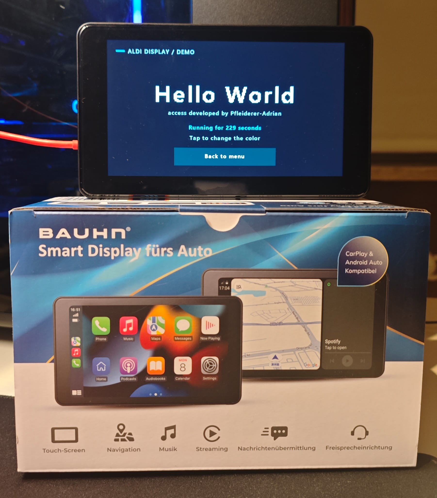

# Aldi Smart Display

[Quick start](docs/quickstart.md)

Community tool for **ADB access, SD-card autostart and native applications** on
the Aldi smart display from 2026. Unofficial project; not affiliated with Aldi or the
device manufacturer.

The demo showes a hello world test application. Tap the background to change its color; **Back to menu** returns to the original
interface.


<br>
<p align="center">
  
</p>

*The Hello World demo running on the BAUHN smart display.*

> WARNING:
> **Flashing modified firmware can brick your display (unusabel) and cause data loss.**
> Follow this guide at your own risk. Compatibility is limited to the tested hardware and firmware;
> a failed flash, incompatible image, or interrupted power supply may prevent the device from booting.
> Keep a verified backup of your own original firmware and the FEL recovery card before making changes.
> Recovery is not guaranteed. This project is provided without warranty.

## What you get

- A builder that enables ADB using **your own factory firmware backup**.
- Automatic USB recovery after the manufacturer's USB-host initialization.
- A firmware hook that starts `/autostart.sh` from the FAT32 data microSD.
- A small native hello world demo that runs directly from the data card.

**Without a data card, or without `autostart.sh`, the manufacturer interface
continues running.** Application updates normally require changing SD files,
not flashing the firmware again.

## Supported hardware

This is deliberately a narrow, tested device profile:

| Item | Tested device |
|---|---|
| Product Name| BAUHN Smart Display fürs Auto |
| SoC | Allwinner V853, FEL ID `0x1886` |
| Internal flash | 16 MiB SPI NOR |
| Screen | 1024 × 600, 16-bit ARGB1555 |
| Touch | Goodix, `/dev/input/event1` |
| FEL USB ID | `1f3a:efe8` |
| ADB USB ID | `18d1:d002` (Tina ADB) |

The firmware builder accepts only the known factory boot/rootfs hashes.
If your firmware differs, it stops. Keep your own backup save.

## Start here

You need the display, its USB data connection, and **two microSD cards**:

1. **FEL card:** for backup, flashing and recovery. Writing its image replaces
   its partition metadata. Keep it separate from the application card.
2. **Data card:** a normal FAT32 card holding `autostart.sh` and the application.

Choose the complete guide for your computer:

- **[Windows guide](docs/windows.md)** — Python, build tools, WinUSB and flashing.
- **[Ubuntu guide](docs/ubuntu.md)** — packages, USB permissions and flashing.

Both guides follow the same sequence:

```text
Build tools → create FEL card → enter FEL → read backup twice
→ build firmware from your backup → review → flash and read back
→ power off → insert FAT32 data card → boot the demo
```

Firmware work requires a reliable power supply. The installer verifies the
entire flash after writing and checks that bytes outside the boot package and
rootfs stayed unchanged. Keep the complete `work/` directory private and backed
up. It contains your original firmware and possibly device-specific settings.

## SD-card layout

For the included demo, copy the **contents** of `sd-card/` directly to your card.
Its source is in `demo/`. To rebuild it, use `tools/build_demo.py` and copy the
**contents** of `build/sd-card/`
to the root of the FAT32 **data** card:

```text
autostart.sh
hello-world/
  start.sh
  hello-world
```

The startup hook invokes `/bin/sh /mnt/extsd/autostart.sh` after USB recovery
finishes. It supplies `SD_ROOT=/mnt/extsd` and sets the working directory to the
card root. Shell scripts must have LF line endings; FAT32 executable bits are
not required for shell scripts. Native programs do need an executable mount,
which the tested firmware uses.

Expect roughly **25 seconds** from power-on until the demo appears. The demo
pauses `cdr` while it owns the screen and resumes it on exit. The generic SD
hook itself does not pause the manufacturer application.

## Development and recovery

- [ADB commands, troubleshooting and replacing the SD application](docs/development.md)
- [How ADB was enabled and what the firmware changes](docs/technical.md)
- [Restore the original boot package and rootfs](docs/recovery.md)
- [Dependency provenance and licensing](THIRD_PARTY.md)

The repository contains source code and the GPL FEL stub, **not manufacturer
firmware images, device backups, Wi-Fi credentials or extracted root filesystems**.
Host downloads and firmware outputs go to ignored `build/` and `work/` folders.

## Validation

On the development device, FEL backup/flashing, root ADB, USB recovery, SD demo
execution, automatic SD startup and boot without a card were tested. The physical
display test caught an important detail: ARGB1555's alpha bit must be set; an
RGB-only preview can look correct while the actual screen is black.

The cleaned host scripts and complete firmware preparation were exercised on
Windows. A GitHub Actions matrix builds/tests the tools on Windows and Ubuntu;
check its results before treating a new platform build as tested. Creating a
repository does not by itself mean that CI has run.

Offline tests:

```text
python -m unittest discover -s tests -v
```

## License

Project code is provided under **GPL-2.0-or-later**, including the modified
linux-sunxi tooling. Third-party files retain their notices and licenses.
DejaVu Sans has its own included font license. See [LICENSE](LICENSE) and
[THIRD_PARTY.md](THIRD_PARTY.md).
