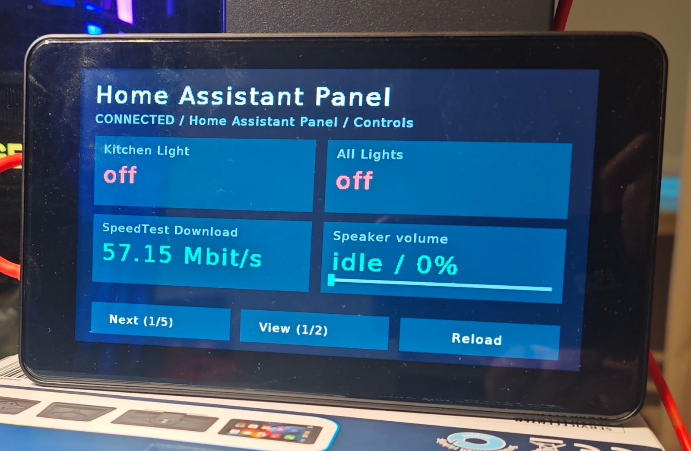

# Home Assistant Dashboard

Native Home Assistant dashboard client for the tested ALDI/BAUHN 1024 x 600
ARMv7 display. This project is separate from `hello-world-demo`.

<p align="center">
  
</p>

## Setup

0. Flash your display -> [Quick start](https://github.com/Pfleiderer-Adrian/aldi-smart-display/blob/main/docs/quickstart.md)
1. Copy `sd-card/home-panel/` from the repository to your FAT32 data card.
2. Copy its `secrets.example.json` to `secrets.json` and enter the **dashboard URL**,
   access token, Wi-Fi name and password. Obtain a long-lived access token from
   your Home Assistant profile's Security tab. Keep this file private.
3. Back up the card's root `autostart.sh`, then replace it with this project's
   `home-panel/autostart.sh`. Reboot normally with the data card.

No PC tools or generated configuration files are needed. The panel reads
`secrets.json` directly and creates only the necessary wpa_supplicant configuration
under `/tmp` in RAM, with mode 600. The SD card needs just one private settings
file. FAT32 itself cannot enforce Unix file permissions.

For a optional manual start through ADB, first stop other display apps, then run:

```sh
/bin/sh /mnt/extsd/home-panel/start-detached.sh
```


## Current card support

| HA card | Native support |
| --- | --- |
| tile, button, entity, sensor | Named state/unit tile and configured tap action |
| entities, glance | Ordinary entity rows flattened into ordered tiles |
| gauge | State/unit tile with a native range bar using min/max |
| heading | Skipped; decorative headings do not occupy tile slots |
| markdown | Short plain text only; no formatting, HTML or templates |
| light, thermostat, media-control, weather-forecast | State tile and configured tap; specialized sliders, HVAC controls, playback controls and forecasts are **not implemented** |
| grid, horizontal-stack, vertical-stack, sections | Ordered traversal; native four-tile layout, not browser geometry |
| conditional, visibility rules | Explicit unsupported placeholder; rules are not bypassed |
| history/statistics graphs, pictures, iframe, custom cards | Explicit unsupported placeholder; no browser renderer |
| media-player-volume-slider tile feature | Native tap/drag volume slider when the entity supports volume_set; updates on release |
| other tile features, hold/double-tap, confirmation dialogs | Not implemented; never silently executed or bypassed |

There are at most 64 native tiles per selected view and 16 view paths in the
View cycle. Oversized tile configurations are rejected.
Fonts currently cover ASCII; non-ASCII text is simplified or replaced.

### Actions

Supported explicit `tap_action` values:

- `toggle`: HA homeassistant.toggle for the configured entity.
- `perform-action`: configured domain/service, object data and object target.
- Legacy `call-service`: configured service, service_data and target.
- `navigate`: another view of the same dashboard.
- `more-info`: local state summary, not the browser's full More info dialog.
- `none`: no action.

Other actions show an unsupported hint. Confirmation-protected actions are
blocked; there is no confirmation dialog yet. Hold/double-tap cards are marked
unsupported. Long presses and drags are not treated as taps. Offline actions are not queued. The client checks that the displayed card still
matches the current configuration before sending its action.


### Volume slider and state colors

A tile's `features: [{type: media-player-volume-slider, show_mute_button: false}]`
enables the volume slider. No slider is added for unconfigured entities. The
native client checks supported_features (VOLUME_SET) and a valid 0..1 volume_level.
Tap or drag the bottom bar and release to send media_player.volume_set; the
slider reads back the actual state after the request. If volume is unavailable,
the bar is disabled. Mute buttons are not implemented; configure
show_mute_button: false. Offline changes are not queued.
